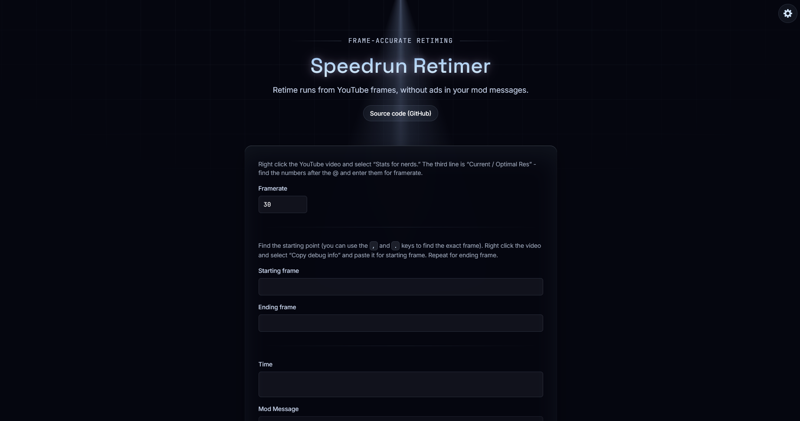

# speedrun-retimer

This is a personal modification of the original Retime website, made purely for fun and personal experimentation.

The project is based on the original work by MCBE-Speedrunning. I have simply modified the website's interface and design to suit my own preferences. This is not an official version or a new project intended to replace the original.

## Original Project

The original project can be found here:

[MCBE-Speedrunning/retime.mcbe.wtf](https://github.com/MCBE-Speedrunning/retime.mcbe.wtf)

All credit for the original project goes to its original authors and contributors.

## Preview

## License

This project is based on software licensed under the GNU General Public License v3.0 (GPL-3.0).

Please refer to the original repository and the included `LICENSE` file for the applicable license terms.
